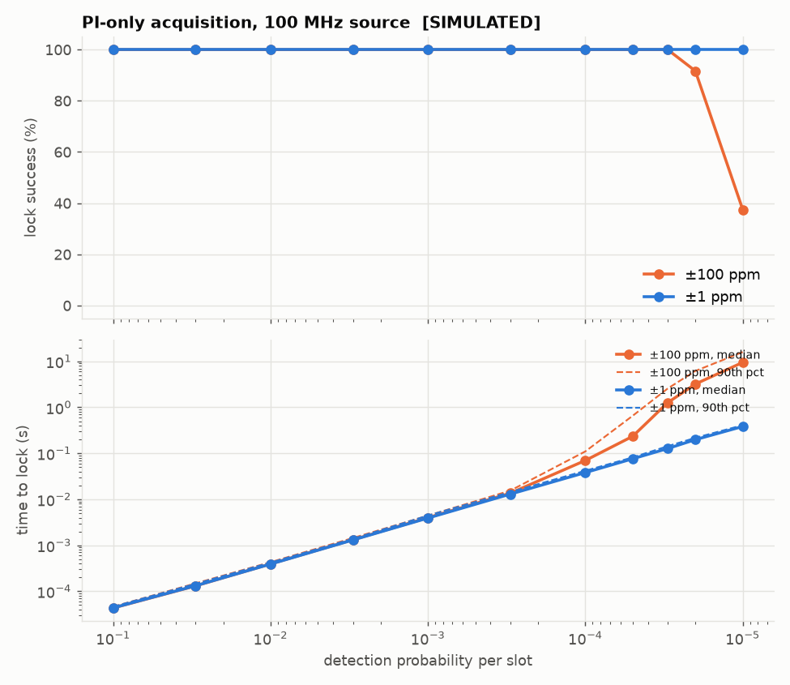
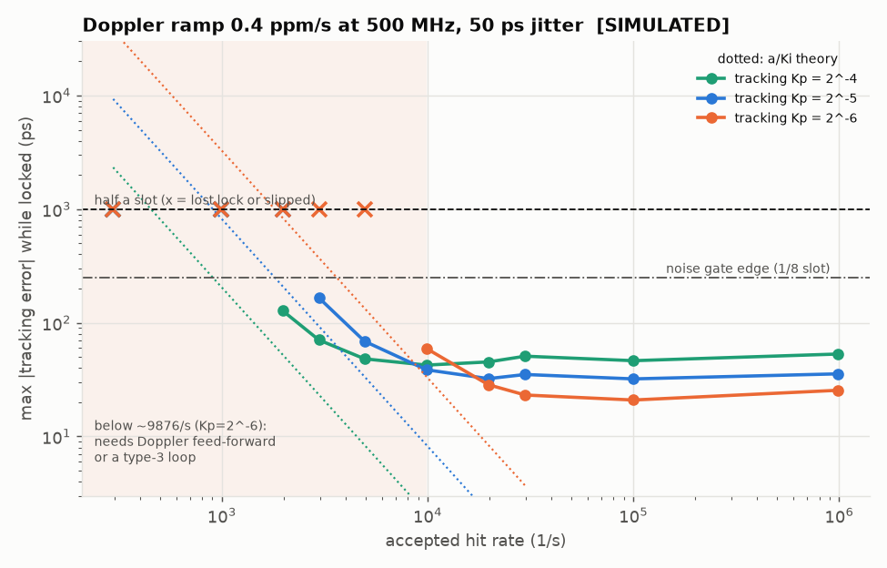
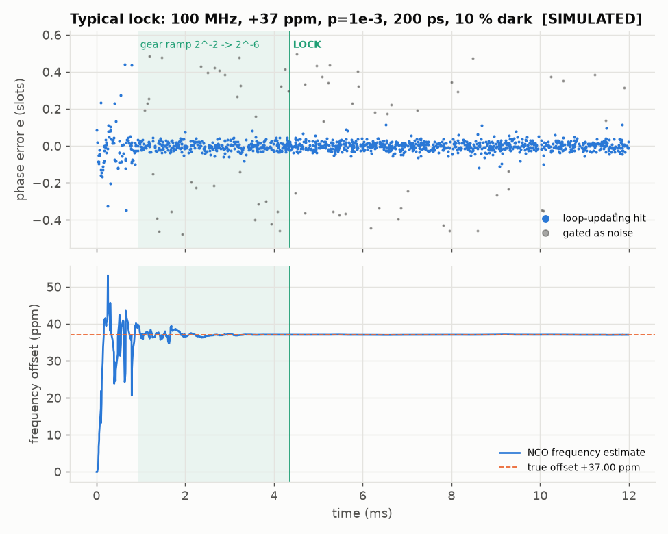

# qkd-tdc: carry-chain TDC for a QKD CubeSat timing payload

This repo is the FPGA timing-synchronisation core for a student 6U CubeSat doing
satellite-to-ground BB84 QKD (modelled on the Jinan-1 architecture):

* **Block 1** (tag `v0.1-tdc-sim`): a **time-to-digital converter (TDC)** built in the
  Artix-7 fast carry chain, plus the simulation, calibration and hardware read-out
  tooling around it.
* **Block 2** (tag `v0.2-nco-sim`): **clock recovery** from the TDC's sparse, jittery,
  noisy photon timestamps: an NCO, phase detector, noise gate, gear-shifted PI loop
  and lock detector, verified bit-exact against a fixed-point model. See
  [Block 2](#block-2-clock-recovery-nco--phase-detector--pi-loop) below.

Optical-link framing, two-way time transfer and the control FSM are later blocks.

> **About the numbers.** Every figure in this README comes from **simulation**
> against a behavioural carry-chain model (`rtl/tdc/tdc_delay_line.v`), unless it's
> explicitly marked as hardware. The model has randomised, seeded tap delays,
> ultra-wide and near-zero bins, per-tap skew (bubbles) and clock jitter. It is
> not a timing-accurate model of real silicon. Hardware numbers go in the
> "Hardware" column once the board has been built and measured
> ([docs/LAB_BUILD.md](docs/LAB_BUILD.md)).

---

## Architecture

```
                         +------------------------ tdc_frontend ------------------------+
 hit (async) --[mux]---->| CARRY4 x 48 -> capture FF -> sync FF -> popcount, 3 stages   |--> fine (9b)
   Pmod JA1     ^        | 192 taps       (same slice)  (ASYNC_REG)  + t0/zero/full flags|--> flags
 ring osc ------+ sw0    +---------------------------------------------------------------+
                                                                        |
 100 MHz --MMCM--> 250 MHz clk --> tdc_coarse_counter (delayed 4 clk) --+--> coarse (48b)
                                                                        v
                                         tdc_hit_detect  (trigger / confirm-full / dead time /
                                                          short-pulse, saturation, re-trigger counters)
                                                                        |
                                                                        v
                                         tdc_calib_lut   fine -> fine_ps  ($readmemh, runtime write)
                                                                        |
                                                                        v
                               tdc_top output register:  m_valid / m_ready
                                                          m_raw = {coarse, fine}
                                                          m_cal = {coarse, fine_ps}
                                                                        |
                               tdc_uart_readout (FIFO, drop+count) --> USB-UART 2 Mbaud --> capture.py
```

| Module | Role |
|---|---|
| `tdc_delay_line` | 48 x CARRY4 (192 taps) + in-slice capture FFs. Behavioural model when not `SYNTHESIS` |
| `tdc_sync` | 2nd register stage (metastability) |
| `tdc_encoder` | pipelined popcount, **3-cycle latency** |
| `tdc_frontend` | the three above + aligned `t0` / `zero` / `full` flags |
| `tdc_coarse_counter` | free-running 48-bit counter, delayed to match the frontend |
| `tdc_hit_detect` | one timestamp per hit, dead time, pulse-width and coverage checks |
| `tdc_calib_lut` | raw code -> ps (ideal linear by default, `.mem` after calibration) |
| `tdc_top` | the TDC channel with its valid/ready output (what blocks 2-4 use) |
| `tdc_uart_readout`, `tdc_uart_tx` | framed UART stream of fine codes / timestamps / status |
| `tdc_ring_osc` | optional on-chip hit source for code-density runs |
| `tdc_arty_top` | board wrapper for the Arty A7-100T (MMCM, switches, LEDs, UART) |

### Time convention

`fine` / `fine_ps` measure **how long before the capture edge** the hit arrived:

```
t_hit = coarse * T_clk - fine_ps        (+ a constant channel offset)
```

- A larger fine value means an **earlier** hit within that clock period.
- A hit at a clock edge can legally come out as `(N, ~0)` or `(N+1, ~T_clk)`. Both
  decode to the same instant (`test_boundary` checks this), so always combine coarse
  and fine with the formula above.
- The constant offset (pad + routing to tap 0 + LUT origin) is the same for every hit.
  The tracking loop absorbs it, or a system-level calibration removes it.
- `coarse` is 48 bits (since block 2; 32 in v0.1): it wraps every 2^48 x 4 ns = 13 days,
  so every timestamp in a ~6 min pass is unique. Take differences modulo 2^48.

### Input assumptions (read these before connecting a detector)

1. **Pulse width W >= chain delay + T_clk (~8.3 ns).** The popcount only measures
   arrival time if the hit stays high while its edge crosses the whole line. A shorter
   pulse travels through the line as a band of 1s, and popcount would then measure its
   *width*. The hit detector holds each candidate until it sees the line completely
   full, and drops and counts (`short_cnt`) any hit that never fills it. So short
   pulses cost data but never produce wrong timestamps. SPAD modules typically output
   10-30 ns pulses, which is fine. If yours are shorter, stretch them (a one-shot
   before the chain).
2. **Chain coverage: the 192-tap line must be longer than T_clk + tap-0 delay.** See
   the next section.
3. **Hit rate.** One hit per dead time (about W + 4.2 ns + 0-4 ns). Satellite-to-ground
   QKD count rates (kHz-MHz) are far below this.

### Chain coverage: the main physical risk

A clock region on Artix-7 is 50 CLB rows tall, and a carry chain can only run up one
column. So at most ~50 CARRY4 fit without crossing a clock-region boundary. We use 48
(192 taps). At the assumed ~22 ps mean per tap that is ~4.22 ns against the 4.04 ns
the line must cover, **a margin of only ~4-5 %.** A faster part, a colder die or a
lower core voltage all make the carry chain faster, and hence *shorter*.

The simulation shows this failure on purpose rather than hiding it. The
`fast_corner` configuration (20 ps/tap, ~9 % faster) **fails** the coverage test:
5 % of hits saturate the line. On hardware, `sat_cnt` (LED3 and the UART status
frame) counts exactly this condition, and **any** non-zero value means the build
doesn't cover the period. The fallback, documented but not built, is two chains in
adjacent columns (or one chain continuing into the next clock region with its own
calibration), read out as one longer line. Raising the clock to ~275 MHz is the other
knob.

At build time, `scripts/build.tcl` also sums Vivado's static-timing delays along the
chain (CYINIT of CARRY4 #0 to CO[3] of #47) and writes `build/reports/chain_delay.rpt`:
**PASS** if the fast-corner minimum exceeds 4.04 ns, otherwise **WARN**. That is an
early warning from the timing model only. `sat_cnt` on the real board is the decisive
check.

---

## Design decisions (and why)

- **CYINIT, not CI (spec correction).** On 7-series the first CARRY4's `CI` can only
  be driven by the `COUT` of a CARRY4 below it. Fabric signals enter a carry chain
  through `CYINIT` (the slice AX pin). The hit therefore drives `CYINIT` of CARRY4 #0,
  and `CI` of each later CARRY4 is the previous `CO[3]`.
- **Capture FFs in the same slice** as their CARRY4 (`CO -> CY -> AFF..DFF`), locked
  with `LOC`/`BEL` constraints. Tap-to-FF routing is then identical and minimal, and
  bin widths come from the carry chain, not from routing.
- **Two register stages** (capture + `tdc_sync`, both `ASYNC_REG`). Only the one or
  two taps the edge is crossing can go metastable, and they move the popcount by at
  most one LSB.
- **Popcount encoder.** For fixed tap thresholds, popcount(tau) = #{taps with
  threshold <= tau}, which is monotonic in tau by construction, whatever order the
  taps switch in (bubbles). A priority encoder is also monotonic while thresholds are
  fixed, but it throws codes away when taps are out of order, and its output depends
  on a single, possibly metastable FF. Measured on the same simulated samples (4 ps
  sweep): **popcount 15 missing codes vs priority encoder 22** (nojitter model:
  10 vs 19). Pipelined 6-bit groups -> 8-way sums -> final sum, 3 cycles, sized for
  250 MHz on a -1 part.
- **Aligned flag pipeline.** `t0`/`zero`/`full` are 192-input reductions split over
  two register stages and delayed to line up with the popcount, so the detector
  reasons about one coherent sample per cycle.
- **Confirm-full before emitting.** Costs 1-2 cycles of latency. In exchange, pulse
  width is verified in hardware on every hit.
- **Saturated hits are dropped and counted**, not emitted. A saturated line has no
  valid fine time.
- **Coarse alignment by delay line**, not by subtraction, so it is exact by
  construction.
- **LUT with a write port.** Block 4 can reload calibration at run time (temperature
  tracking) without a rebuild.
- **Drop-and-count, never overwrite.** A 1-deep output register plus a FIFO in the UART
  readout. Everything lost is counted (`drop_cnt`, `short_cnt`, `sat_cnt`).

### Hardware readout

- **UART:** 2 000 000 baud 8N1. That is exact from 250 MHz (divisor 125), and the
  FT2232H generates it exactly too. Throughput is 200 kB/s: ~100 k fine codes/s or
  ~22 k full timestamps/s.
- **Framing** is self-synchronising: only header bytes have bit 7 set, so the PC can
  join mid-stream.

  | Type | Bytes | Payload |
  |---|---|---|
  | 0 FINE | 2 | fine code |
  | 1 TIMESTAMP | 9 | {coarse (48 bit), fine} (7 bytes / 32-bit coarse in v0.1) |
  | 2 STATUS | 8 | drop / short / sat counters; every 0.27 s and after reset |
  | 3 TELEMETRY | 25 | block 2 loop state, frequency, error averages, counters (M1 top) |

  Header byte `1TTPPPPP`, continuation bytes `0PPPPPPP`, payload MSB first. Parsed
  by `scripts/capture.py`. The same parser checks the RTL in `test_uart.py`.
- **Bursts:** a 512-entry BRAM FIFO. When it is full, new hits are dropped and
  counted, never overwritten. Drops depend on FIFO occupancy, not on the fine code,
  so they don't bias code density.
- **On-chip hit source (SW0):** a 5-LUT ring oscillator divided by 2^12. It needs
  `DONT_TOUCH` and `ALLOW_COMBINATORIAL_LOOPS` (both in RTL/XDC) and its own
  asynchronous clock. Caveat: a ring on the same die can injection-lock to the
  system clock, so cross-check against an external generator.

### Where the spec was changed

- **Hit input to the chain:** `CI` became `CYINIT`. `CI` of the first CARRY4 cannot
  be driven from fabric on 7-series.
- **Priority-encoder claim:** a bubble does not make a priority encoder
  non-monotonic when thresholds are fixed. What it does is create missing codes and
  a single-FF dependency. The comments and the sweep test say that and measure it.
- **Chain coverage:** 192 x 22 ps leaves a thin margin (see above). The limit comes
  from the 50-row clock region, so no parameter change inside one region fixes it.
- **Placement constraints:** per-tap `LOC`/`BEL` constraints live in a Tcl file
  (`constraints/tdc_chain_place.tcl`) instead of the XDC, because they need a loop and
  XDC only supports a Tcl subset. The pblock stays in the XDC, and the Tcl derives
  every location from it.
- **Build order:** the calibration LUT module was written in step 2 (not 3), because
  `tdc_top` needs its calibrated output port.

---

## Results

Chain model: `default` config: 48 x CARRY4, TAP_NOM_PS = 22, per-tap sigma 15 %,
skew 6 ps, jitter 4 ps rms, SEED = 1. Calibration set: 50 000 random hits. Validation
set: a **separate** 20 000 hits with known true times, never used for calibration.
Numbers come from a clean `python sim/run_tests.py` full run. The model's jitter RNG
is one stream per simulation, so running a single test alone gives slightly
different values in the last digit.

| Metric | Simulated | Hardware |
|---|---|---|
| Codes used / missing | 1..184 (184 codes) / 1 | _TBD_ |
| Mean bin width (LSB) | **21.7 ps** | _TBD_ |
| Largest / smallest bin | 65.5 ps / 0.0 ps | _TBD_ |
| Raw DNL | -1.00 .. +2.01 LSB | _TBD_ |
| Raw INL (bin centres, code density) | -6.33 .. +1.53 LSB | _TBD_ |
| Uncalibrated INL on validation set (ideal 22 ps LUT) | max \|INL\| 3.8 LSB | _TBD_ |
| **Residual INL after calibration** (validation set) | **max 0.26 LSB (5.7 ps)** | _TBD_ |
| RMS single-shot error, uncalibrated | 37.1 ps | _TBD_ |
| **RMS single-shot error, calibrated (headline)** | **11.7 ps** (target < 50, limit < 100) | _TBD_ |
| Quantisation-only floor (from bin widths) | 10.8 ps | _TBD_ |
| Code-density width estimate vs model ground truth | 3.3 ps rms | n/a |
| Saturated (coverage) hits, default chain | 0 / 3000 (max code 184 of 192) | _TBD_ (`sat_cnt`) |
| Saturated hits, fast corner (20 ps/tap) | **150 / 3000 (5 %), FAIL** | n/a |
| Dead time (W = 12 ns, rise-to-rise) | accepted from 16.75 ns, always above 20.0 ns | _TBD_ |
| Encoder latency | 3 clk (12 ns) | same (RTL) |
| Capture edge -> `m_valid` | 8 clk (32 ns) | same (RTL) |
| Boundary test worst deviation (846 hits across edges) | 84 ps ideal LUT, **30 ps calibrated** | n/a |
| Utilisation (LUT / FF / BRAM / carry) | n/a | _TBD_ |
| Fmax / WNS at 250 MHz | n/a | _TBD_ |

How to read this:
- The calibrated 11.7 ps is what the model allows: sqrt(10.8^2 quantisation +
  4^2 model jitter) = 11.5 ps. Real hardware adds clock jitter from the MMCM, supply
  noise, temperature drift between calibration and use, and hit-path jitter. Expect
  it to be worse, typically tens of ps for a single Artix-7 chain. The < 50 ps target
  is plausible, but only a hardware measurement can confirm it.
- Raw DNL of -1 marks zero-width bins (taps that never produce their own code). That
  is normal for carry chains, and calibration handles it.
- "Raw INL" from code density uses the endpoint LSB (T / 184 codes). "Uncalibrated
  INL on validation" uses the 22 ps ideal LUT. They answer different questions, so
  their values differ.

Plots (all SIMULATED, regenerate with `analyze.py`):

| | |
|---|---|
|  |  |
|  |  |
|  |  |

---

---

# Block 2: clock recovery (NCO + phase detector + PI loop)

> **All block 2 numbers are SIMULATED.** They come from `model/loop_float.py`
> (long statistical runs), `model/loop_fixed.py` (bit-exact model) and the cocotb
> RTL tests in `sim/nco/` and `sim/integration/`. No hardware result exists yet.

## What it does

The TDC timestamps photons. Most slots carry no detection (probability per slot
from ~0.5 down to 1e-5), arrivals are jittered (50–500 ps RMS), and dark counts
add uniform noise. The source runs on a different crystal than our 250 MHz clock
(up to ±100 ppm apart, drifting with orbital Doppler). Block 2 rebuilds the
source's clock from this sparse stream. Every photon then gets the right
**slot number**, i.e. which source pulse it came from. The worst failure is a
**cycle slip**: the NCO gains or loses one slot, and every later slot number
is wrong.

```
 TDC {coarse, fine_ps} -> nco_align -> nco_phase_det -> gate / loop filter / lock det
   (valid/ready)           FIFO        A B C D            E (update) F (decide)
                    t_nco = coarse_now - 16              |        |
                                     nco_core <-- dphi, df (cycle n+6)
                                     88-bit phase, f in slots/ps, ext correction port
 per hit out: {slot[47:0], residual_ps, noise_flag, locked, e24, tag}
```

| Module | Role |
|---|---|
| `nco_align` | holds each timestamp until NCO time reaches it; exact late release (`fine' = fine + j·4000`, j ≤ 12); counts late hits |
| `nco_core` | 48-bit slot index + 40-bit fraction; frequency in slots/ps; documented valid-strobed **external correction port** (unused by default) |
| `nco_phase_det` | NCO phase at the photon with **one** 25×17 multiply, wrap to [−0.5, 0.5), slot = round, residual in ps |
| `nco_gate` | noise window ±g (runtime register, default 1/8 slot); at most 1 − 2g of uniform noise can be rejected |
| `nco_loop_filter` | type-2 PI, shift-only gains, Ki = Kp²/2 (ζ = 0.707), gear ramp 2^-2 → 2^-6, power-of-two hit-rate gain scaling with register override |
| `nco_lock_det` | ACQ → RAMP → LOCK state machine, e² average (hysteresis), reject run, no-hit timeout, signed-error slip suspicion; `unlock_cnt`, `suspect_cnt`, `abort_cnt` |
| `nco_top` | valid/ready in/out, telemetry outputs, all configuration registers |

`model/loop_float.py` documents the algorithm and why each gain was chosen.
`model/loop_fixed.py` pins every width, rounding and register-update cycle; the
RTL must equal it **bit for bit on every hit**, and in every test it does.

### Loop and gains (why)

* Per hit: `e = φ_NCO(t_hit) − round(·)`, `phase −= 2^-kp·e`,
  `f −= 2^-(2kp+1)·e / (2^L·2^12)` slots/ps. Ki = Kp²/2 gives damping 0.707 with
  both gains as pure shifts.
* **Hit-rate scaling:** the frequency step is divided by the mean hit spacing
  2^L clocks (an exponential average rounded to a power of two, so a shift). The
  per-hit dynamics are then the same at 10 M hits/s and at 1 k hits/s.
* **Gear ramp before lock:** ACQ uses Kp = 2^-2. When the e² average drops below
  1/64 (phase acquired → RAMP), Kp halves every 64 loop updates down to 2^-6.
  After another 64 updates, LOCK is declared only if the error is still small.
  The float model forced this design (see "Where the spec was changed").
* **Lock detector:** e² average with weight 2^-5 while acquiring and 2^-7 once
  locked. Lock below 1/64, unlock above 1/16, or after 16 consecutive gated
  hits, or after no hit for 2^(L+5) clocks (32 mean spacings), or on a
  suspected slip (signed-error average beyond ±1/8 slot).

### Time convention end to end

`t_hit = coarse·T_clk − fine_ps`, exactly as block 1. The NCO's time axis
t_nco runs 16 clocks behind the TDC coarse counter. The phase detector
interpolates `φ(t_hit) = phase[c] − fine_ps·f`. `sim/integration/test_tdc_nco.py`
drives real pulses through the behavioural TDC into the NCO and checks every
slot against the source. A wrong sign or a wrong edge association in the
convention would make that test fail; it passes.

## Block 2 results (SIMULATED)

**Acquisition (float model, PI only, 100 MHz, 200 ps jitter, dark counts 10 % of
signal, 24 trials per point; success = lock within 20 000 hits, then 2 000 signal
hits with no unlock and no slip):**

| p per slot | accepted rate | ±1 ppm: success / median lock | ±100 ppm: success / median (p90) lock |
|---|---|---|---|
| 1e-1 | 9.6 M/s (offered 11 M/s, dead time) | 100 % / 44 µs | 100 % / 43 µs |
| 1e-2 | 1.1 M/s | 100 % / 0.39 ms | 100 % / 0.39 ms |
| 1e-3 | 110 k/s | 100 % / 3.9 ms | 100 % / 4.0 ms |
| 1e-4 | 11 k/s | 100 % / 38 ms | 100 % / 70 ms (0.11 s) |
| 3e-5 | 3.3 k/s | 100 % / 0.13 s | 100 % / 1.3 s (2.6 s) |
| 2e-5 | 2.2 k/s | 100 % / 0.20 s | **92 %** / 3.2 s (6.2 s) |
| 1e-5 | 1.1 k/s | 100 % / 0.38 s | **38 %** / 9.5 s (16 s) |

* **Where PI-only fails:** from ±100 ppm, below p ≈ 3e-5 (1e8 · p ≈ 3 k hits/s).
  The phase drifts > 3 slots between mean hits and only rare short intervals
  carry phase information. From ±1 ppm (GPS-disciplined oscillators) PI-only
  works at 100 % down to 1e-5. By the agreed rule, the **sweep-and-dwell aid is
  designed but not built** (below).
* Lock takes ~420 hits (~380 signal photons) at every rate where pull-in is
  easy; lock time is simply 420 / rate.
* Stress (500 ps jitter, dark counts 50 % of signal): 100 % down to 3e-4 at
  both offsets, 92–100 % below; lock takes ~4 000 hits (the e² average needs
  longer to drop below threshold with that much noise).

**Slot integrity:**

| | Result |
|---|---|
| Float model "slip hunt", 512 runs × 2 conditions, 1e-2 … 3e-5, ±100 / ±1 ppm | **0 undetected slips, 0 false unlocks in 23.3 M locked hits** (10.8 M typical + 12.5 M stress) |
| RTL tests (100 MHz and 500 MHz, every hit compared with the true slot) | **0 slips** in every lock run |
| TDC → NCO integration (behavioural carry chain, 1 234 pulses, +23 ppm) | bit-exact, **one** slot offset for all 804 locked signal photons |

**RTL tests (`sim/nco/`, bit-exact vs `loop_fixed.py` on every hit, 2 M photons/s
offered unless noted):**

| Test | 100 MHz | 500 MHz |
|---|---|---|
| Static lock | 376 hits, 186 µs, 0 slips | 381 hits, 191 µs, 0 slips |
| Offset −100 / −37.5 / +50 / +100 ppm | all lock in ~375 hits; f within 0.35 ppm (instantaneous), 0 slips | same, f within 0.18 ppm |
| Sparsity p = 0.3 / 1e-2 / 3e-3 / 1e-3 | lock 18 µs / 0.37 ms / 1.2 ms / 3.6 ms; offered vs accepted 30.9 vs 21.0 M/s at p = 0.3 (TDC dead time), ≤ 1 % loss below | n/a |
| Jitter 50 / 200 / 500 ps (100 MHz), 20 / 50 / 100 ps (500 MHz) | residual RMS 54 / 213 / 501 ps, 0 slips | 25 / 55 / 100 ps, 0 slips |
| Dark counts 50 % of signal | gate flags **76.5 %** of dark counts (ceiling 75 % ± stat.) and **0 %** of signal photons | n/a |
| Drift ramp (accelerated 2 000 ppm/s) | tracks to 21.96 vs 22.00 ppm, 0 slips | n/a |
| 10 ms signal gap | unlock reported, re-acquired, 0 slips in each lock run | same |
| Coincident hits (3 at once) + late hits | exact, 5/5 late hits counted | n/a |
| External correction (+0.05 slot, +0.5 ppm) | applied exactly, loop absorbs it, 0 slips | n/a |
| Output back-pressure | 117 results dropped and counted, loop state untouched | n/a |

`residual_ps` is the photon's offset from the NCO's slot centre, so its RMS is
dominated by the photon jitter itself. **The NCO's own tracking error** (true
source phase minus NCO, float model, 500 MHz, 50 ps jitter) is **5.7 ps RMS**
at ≥ 1e5 hits/s with Kp = 2^-6 (11.5 ps with 2^-4).

**Doppler (float model, 500 MHz, 0.4 ppm/s ramp, 50 ps jitter):**

| Tracking gear | lowest accepted rate that tracks (no unlock, no slip) | max error there |
|---|---|---|
| Kp = 2^-6 (default) | **~1×10^4 hits/s** | 59 ps |
| Kp = 2^-5 | ~3×10^3 hits/s | 166 ps |
| Kp = 2^-4 | ~2×10^3 hits/s | 128 ps |

The type-2 steady-state error a/Ki matches the simulation (dotted lines in the
plot). Below these rates the ramp needs **Doppler feed-forward** (orbit
prediction; residual ramp ×10 smaller lowers the rate requirement ×√10) or a
**type-3 loop**. `kp_trk` is a register, so 2^-4 can be selected for low-rate
passes at the cost of ~2× more NCO jitter.

**500 ps jitter at 500 MHz is a physical limit, not a design target:** 500 ps
is 0.25 slot RMS, so even with a perfect clock 4.6 % of photons land in a
neighbouring slot. The locked e² average (≈ 0.0625) equals the unlock
threshold, so the loop will not hold lock with the defaults. Needed: ≤ ~100 ps
at 500 MHz (0.05 slot, 0 slot errors).

**Resources:** not estimated yet (no Vivado here). Main items: one DSP48 (phase
interpolation) + one for e² + one for residual_ps, an 88-bit phase adder, a
96-bit barrel shifter in the loop filter, a 16-deep × 68-bit align FIFO.

| | |
|---|---|
|  |  |
|  | |

### Sweep-and-dwell acquisition aid (designed, not built)

Needed only for ±100 ppm initial uncertainty below ~3e-5 per slot. Step the
NCO frequency through bins of width Δf ≈ 0.1 × p (relative; 1 ppm at p = 1e-5),
so that within a bin the drift between mean hits stays < 0.1 slot. Dwell
~50 loop updates per bin in the acquisition gear and test the e² average
against the lock threshold. ±100 ppm at p = 1e-5 means 200 bins × 50 hits =
10 000 hits ≈ 10 s, versus 38 % success in 18 s for PI only. Implementation:
a counter that writes the bin frequency through the external correction
port while unlocked, plus a dwell timer. That port and the lock detector
already exist, so it is ~100 LUTs of control. A coherent search (FFT of
phase histories in software) would be faster if a processor is available.

### Where the spec was changed (block 2)

1. **Gear shift.** Spec: acquisition Kp = 2^-2 → tracking 2^-6 on lock. Built: a
   gradual ramp (one step per 64 updates) that runs *before* LOCK is declared
   (ACQ → RAMP → LOCK). A direct jump caused a gate freeze-out and an unlock (1 in 24
   trials at p = 5e-5). A ramp after lock still let a noisy acquisition-gear
   frequency estimate through: 2 undetected slips in 13 M locked hits under
   stress. Ramp-before-lock gave 0 in 23 M. Cost: ~320 more hits to lock.
2. **Lock detector:** two averaging weights (2^-5 acquiring, 2^-7 locked):
   false unlocks at 50 % dark counts dropped from 34 to 1 per 1.65 M hits.
   Plus: a suspected slip forces an unlock (register `slip_unlock`, default 1),
   and the slip detector looks at all hits, not just gate-passed ones.
3. **nco_align** releases a hit when NCO time ≥ its coarse time (not only ==),
   rewriting fine exactly for up to 12 cycles late. Needed for coincident hits
   from several channels; at most one release per 2 clocks so every hit's
   control logic sees the previous hit's decisions.
4. **Frequency stored in slots/ps** (not slots/clock) so phase interpolation is
   one multiply; the per-clock increment is a constant ×4000 (shift-and-add).
5. **TDC coarse counter widened to 48 bits** (13 days wrap); UART TIMESTAMP
   frame 7 → 9 bytes; TELEMETRY frame (type 3) added to the readout and
   `capture.py`. The block 1 board wrapper does not drive it (no NCO there);
   the M1 top will.
6. The lock-declaration noise limit of an e² metric (lock up to dark/signal ≈
   0.6 with default thresholds) is documented; thresholds are registers.

### Open risks (block 2)

* **Timing closure at 250 MHz is unverified** (no Vivado here). Most at risk: the
  88-bit 4-input phase adder in `nco_core`, the E stage (barrel shift + e²
  average update), the 48-bit compare + `j·4000` in `nco_align`. Mitigations
  if needed: carry-select/pipelined accumulator, one more pipeline stage (the
  model's POP_GAP and latency are parameters to change in both RTL and model).
* Ramp tracking below ~1e4 hits/s at 500 MHz needs feed-forward or type-3 (above).
* ±100 ppm acquisition below 3e-5 needs sweep-and-dwell or GPS-disciplined clocks.
* Lock declaration degrades with dark counts above ~60 % of the signal rate.
* All of this is simulation against a behavioural TDC and Gaussian jitter; real
  detector jitter tails (afterpulsing, non-Gaussian) are not modelled.


## Running it

### Simulation (Windows or Linux, no Vivado needed)

```sh
python -m venv .venv
.venv\Scripts\activate            # Linux: source .venv/bin/activate
pip install -r requirements.txt   # Icarus Verilog must be on PATH

python sim/run_tests.py                       # all configs (~30 min, mostly code density + UART)
python sim/run_tests.py --config default --suite top --test test_boundary
python sim/run_tests.py --block tdc           # one block's suites (tdc, nco, integration)
python sim/run_tests.py --suite nco           # block 2 RTL, 100 MHz (nco500: 500 MHz)
python model/loop_float.py                    # block 2 sweeps + plots (~3 min, 16 cores)
python model/loop_fixed.py                    # fixed-point model sanity run
```

Configurations: `default`; `nojitter` (strict monotonicity); `fast_corner` (coverage
tests are **expected** to fail and are reported as XFAIL); `calibrated` (the RTL loads
the LUT that `calibrate.py` built from the default run). On Linux, `make -C sim` wraps
the same runner.

### Calibration and analysis

```sh
python scripts/calibrate.py sim/out/default/fine_codes.csv --period-ps 4000 \
       --out sim/out/default/calib_lut.mem --summary sim/out/default/calib_lut.json
python scripts/analyze.py --codes sim/out/default/fine_codes.csv \
       --validation sim/out/default/validation.csv --lut sim/out/default/calib_lut.mem \
       --model sim/out/default/model_thresholds.csv --outdir docs/img --label SIMULATED
```

**Input format** (simulation and hardware alike): text/CSV, **one integer raw fine
code per line**. `#` lines are comments, and only the first comma-separated column is
used. `validation.csv` is `fine,tau_true_ps[,...]`.

### Hardware

See [docs/LAB_BUILD.md](docs/LAB_BUILD.md) for build, programming, capture and
calibration on the lab machine.

## Repo layout

```
rtl/tdc/          block 1: carry-chain TDC (all Xilinx primitives behind `ifdef SYNTHESIS)
rtl/nco/          block 2: NCO, phase detector, loop filter, lock detector
rtl/top/          board wrapper (tdc_arty_top), UART readout
sim/run_tests.py  cocotb runner for every block (+ Linux Makefile)
sim/tdc/          block 1 cocotb tests
sim/nco/          block 2 cocotb tests
sim/integration/  TDC -> NCO end-to-end tests
model/            Python reference models (float + bit-exact fixed point)
constraints/      XDC (clocks, pins, pblock, false paths) + chain placement Tcl
scripts/          build.tcl, calibrate.py, analyze.py, capture.py
docs/             LAB_BUILD.md, plots
build/            Vivado output (gitignored)
```
