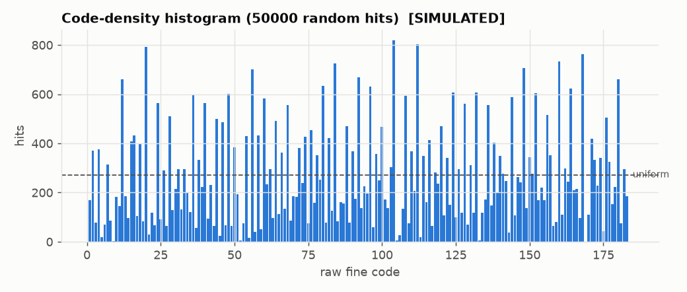
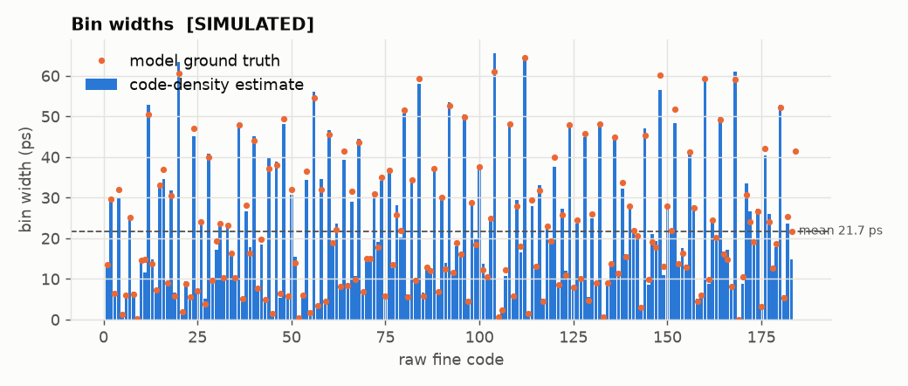
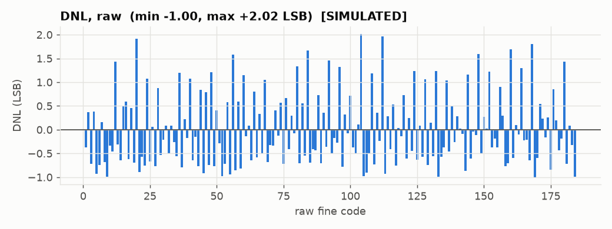
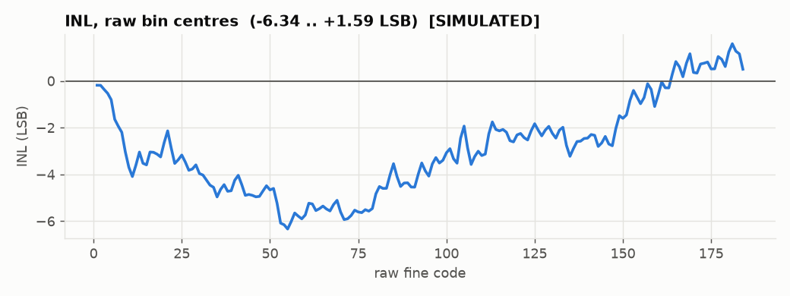
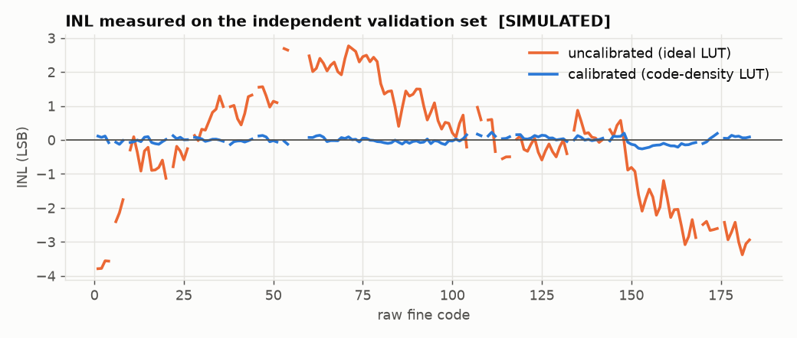
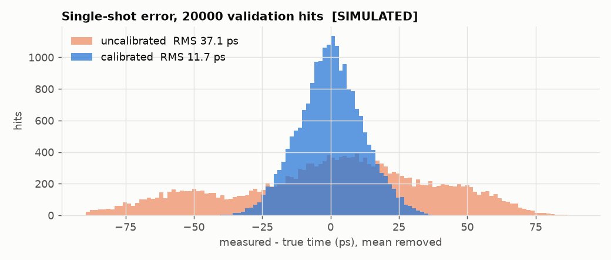

# qkd-tdc: carry-chain TDC for a QKD CubeSat timing payload

This repo is block 1 of the FPGA timing-synchronisation core for a student 6U CubeSat
doing satellite-to-ground BB84 QKD (modelled on the Jinan-1 architecture). It is a
**time-to-digital converter (TDC)** built in the Artix-7 fast carry chain, plus the
simulation, calibration and hardware read-out tooling around it.

Blocks 2 to 4 (phase detector + loop filter + NCO, optical-link framing,
control/calibration FSM) are out of scope here. The TDC output interface is designed
so those blocks can consume it directly.

> **About the numbers.** Every figure in this README comes from **simulation**
> against a behavioural carry-chain model (`rtl/tdc/tdc_delay_line.v`), unless it's
> explicitly marked as hardware. The model has randomised, seeded tap delays,
> ultra-wide and near-zero bins, per-tap skew (bubbles) and clock jitter. It is
> not a timing-accurate model of real silicon. Hardware numbers go in the
> "Hardware" column once the board has been built and measured
> ([docs/LAB_BUILD.md](docs/LAB_BUILD.md)).

---

## Architecture

```
                         +------------------------ tdc_frontend ------------------------+
 hit (async) --[mux]---->| CARRY4 x 48 -> capture FF -> sync FF -> popcount, 3 stages   |--> fine (9b)
   Pmod JA1     ^        | 192 taps       (same slice)  (ASYNC_REG)  + t0/zero/full flags|--> flags
 ring osc ------+ sw0    +---------------------------------------------------------------+
                                                                        |
 100 MHz --MMCM--> 250 MHz clk --> tdc_coarse_counter (delayed 4 clk) --+--> coarse (32b)
                                                                        v
                                         tdc_hit_detect  (trigger / confirm-full / dead time /
                                                          short-pulse, saturation, re-trigger counters)
                                                                        |
                                                                        v
                                         tdc_calib_lut   fine -> fine_ps  ($readmemh, runtime write)
                                                                        |
                                                                        v
                               tdc_top output register:  m_valid / m_ready
                                                          m_raw = {coarse, fine}
                                                          m_cal = {coarse, fine_ps}
                                                                        |
                               tdc_uart_readout (FIFO, drop+count) --> USB-UART 2 Mbaud --> capture.py
```

| Module | Role |
|---|---|
| `tdc_delay_line` | 48 x CARRY4 (192 taps) + in-slice capture FFs. Behavioural model when not `SYNTHESIS` |
| `tdc_sync` | 2nd register stage (metastability) |
| `tdc_encoder` | pipelined popcount, **3-cycle latency** |
| `tdc_frontend` | the three above + aligned `t0` / `zero` / `full` flags |
| `tdc_coarse_counter` | free-running 32-bit counter, delayed to match the frontend |
| `tdc_hit_detect` | one timestamp per hit, dead time, pulse-width and coverage checks |
| `tdc_calib_lut` | raw code -> ps (ideal linear by default, `.mem` after calibration) |
| `tdc_top` | the TDC channel with its valid/ready output (what blocks 2-4 use) |
| `tdc_uart_readout`, `tdc_uart_tx` | framed UART stream of fine codes / timestamps / status |
| `tdc_ring_osc` | optional on-chip hit source for code-density runs |
| `tdc_arty_top` | board wrapper for the Arty A7-100T (MMCM, switches, LEDs, UART) |

### Time convention

`fine` / `fine_ps` measure **how long before the capture edge** the hit arrived:

```
t_hit = coarse * T_clk - fine_ps        (+ a constant channel offset)
```

- A larger fine value means an **earlier** hit within that clock period.
- A hit at a clock edge can legally come out as `(N, ~0)` or `(N+1, ~T_clk)`. Both
  decode to the same instant (`test_boundary` checks this), so always combine coarse
  and fine with the formula above.
- The constant offset (pad + routing to tap 0 + LUT origin) is the same for every hit.
  The tracking loop absorbs it, or a system-level calibration removes it.
- `coarse` wraps every 2^32 x 4 ns = 17.2 s. Take differences modulo 2^32.

### Input assumptions (read these before connecting a detector)

1. **Pulse width W >= chain delay + T_clk (~8.3 ns).** The popcount only measures
   arrival time if the hit stays high while its edge crosses the whole line. A shorter
   pulse travels through the line as a band of 1s, and popcount would then measure its
   *width*. The hit detector holds each candidate until it sees the line completely
   full, and drops and counts (`short_cnt`) any hit that never fills it. So short
   pulses cost data but never produce wrong timestamps. SPAD modules typically output
   10-30 ns pulses, which is fine. If yours are shorter, stretch them (a one-shot
   before the chain).
2. **Chain coverage: the 192-tap line must be longer than T_clk + tap-0 delay.** See
   the next section.
3. **Hit rate.** One hit per dead time (about W + 4.2 ns + 0-4 ns). Satellite-to-ground
   QKD count rates (kHz-MHz) are far below this.

### Chain coverage: the main physical risk

A clock region on Artix-7 is 50 CLB rows tall, and a carry chain can only run up one
column. So at most ~50 CARRY4 fit without crossing a clock-region boundary. We use 48
(192 taps). At the assumed ~22 ps mean per tap that is ~4.22 ns against the 4.04 ns
the line must cover, **a margin of only ~4-5 %.** A faster part, a colder die or a
lower core voltage all make the carry chain faster, and hence *shorter*.

The simulation shows this failure on purpose rather than hiding it. The
`fast_corner` configuration (20 ps/tap, ~9 % faster) **fails** the coverage test:
5 % of hits saturate the line. On hardware, `sat_cnt` (LED3 and the UART status
frame) counts exactly this condition, and **any** non-zero value means the build
doesn't cover the period. The fallback, documented but not built, is two chains in
adjacent columns (or one chain continuing into the next clock region with its own
calibration), read out as one longer line. Raising the clock to ~275 MHz is the other
knob.

At build time, `scripts/build.tcl` also sums Vivado's static-timing delays along the
chain (CYINIT of CARRY4 #0 to CO[3] of #47) and writes `build/reports/chain_delay.rpt`:
**PASS** if the fast-corner minimum exceeds 4.04 ns, otherwise **WARN**. That is an
early warning from the timing model only. `sat_cnt` on the real board is the decisive
check.

---

## Design decisions (and why)

- **CYINIT, not CI (spec correction).** On 7-series the first CARRY4's `CI` can only
  be driven by the `COUT` of a CARRY4 below it. Fabric signals enter a carry chain
  through `CYINIT` (the slice AX pin). The hit therefore drives `CYINIT` of CARRY4 #0,
  and `CI` of each later CARRY4 is the previous `CO[3]`.
- **Capture FFs in the same slice** as their CARRY4 (`CO -> CY -> AFF..DFF`), locked
  with `LOC`/`BEL` constraints. Tap-to-FF routing is then identical and minimal, and
  bin widths come from the carry chain, not from routing.
- **Two register stages** (capture + `tdc_sync`, both `ASYNC_REG`). Only the one or
  two taps the edge is crossing can go metastable, and they move the popcount by at
  most one LSB.
- **Popcount encoder.** For fixed tap thresholds, popcount(tau) = #{taps with
  threshold <= tau}, which is monotonic in tau by construction, whatever order the
  taps switch in (bubbles). A priority encoder is also monotonic while thresholds are
  fixed, but it throws codes away when taps are out of order, and its output depends
  on a single, possibly metastable FF. Measured on the same simulated samples (4 ps
  sweep): **popcount 15 missing codes vs priority encoder 22** (nojitter model:
  10 vs 19). Pipelined 6-bit groups -> 8-way sums -> final sum, 3 cycles, sized for
  250 MHz on a -1 part.
- **Aligned flag pipeline.** `t0`/`zero`/`full` are 192-input reductions split over
  two register stages and delayed to line up with the popcount, so the detector
  reasons about one coherent sample per cycle.
- **Confirm-full before emitting.** Costs 1-2 cycles of latency. In exchange, pulse
  width is verified in hardware on every hit.
- **Saturated hits are dropped and counted**, not emitted. A saturated line has no
  valid fine time.
- **Coarse alignment by delay line**, not by subtraction, so it is exact by
  construction.
- **LUT with a write port.** Block 4 can reload calibration at run time (temperature
  tracking) without a rebuild.
- **Drop-and-count, never overwrite.** A 1-deep output register plus a FIFO in the UART
  readout. Everything lost is counted (`drop_cnt`, `short_cnt`, `sat_cnt`).

### Hardware readout

- **UART:** 2 000 000 baud 8N1. That is exact from 250 MHz (divisor 125), and the
  FT2232H generates it exactly too. Throughput is 200 kB/s: ~100 k fine codes/s or
  ~28 k full timestamps/s.
- **Framing** is self-synchronising: only header bytes have bit 7 set, so the PC can
  join mid-stream.

  | Type | Bytes | Payload |
  |---|---|---|
  | 0 FINE | 2 | fine code |
  | 1 TIMESTAMP | 7 | {coarse, fine} |
  | 2 STATUS | 8 | drop / short / sat counters; every 0.27 s and after reset |

  Header byte `1TTPPPPP`, continuation bytes `0PPPPPPP`, payload MSB first. Parsed
  by `scripts/capture.py`. The same parser checks the RTL in `test_uart.py`.
- **Bursts:** a 512-entry BRAM FIFO. When it is full, new hits are dropped and
  counted, never overwritten. Drops depend on FIFO occupancy, not on the fine code,
  so they don't bias code density.
- **On-chip hit source (SW0):** a 5-LUT ring oscillator divided by 2^12. It needs
  `DONT_TOUCH` and `ALLOW_COMBINATORIAL_LOOPS` (both in RTL/XDC) and its own
  asynchronous clock. Caveat: a ring on the same die can injection-lock to the
  system clock, so cross-check against an external generator.

### Where the spec was changed

- **Hit input to the chain:** `CI` became `CYINIT`. `CI` of the first CARRY4 cannot
  be driven from fabric on 7-series.
- **Priority-encoder claim:** a bubble does not make a priority encoder
  non-monotonic when thresholds are fixed. What it does is create missing codes and
  a single-FF dependency. The comments and the sweep test say that and measure it.
- **Chain coverage:** 192 x 22 ps leaves a thin margin (see above). The limit comes
  from the 50-row clock region, so no parameter change inside one region fixes it.
- **Placement constraints:** per-tap `LOC`/`BEL` constraints live in a Tcl file
  (`constraints/tdc_chain_place.tcl`) instead of the XDC, because they need a loop and
  XDC only supports a Tcl subset. The pblock stays in the XDC, and the Tcl derives
  every location from it.
- **Build order:** the calibration LUT module was written in step 2 (not 3), because
  `tdc_top` needs its calibrated output port.

---

## Results

Chain model: `default` config: 48 x CARRY4, TAP_NOM_PS = 22, per-tap sigma 15 %,
skew 6 ps, jitter 4 ps rms, SEED = 1. Calibration set: 50 000 random hits. Validation
set: a **separate** 20 000 hits with known true times, never used for calibration.
Numbers come from a clean `python sim/run_tests.py` full run. The model's jitter RNG
is one stream per simulation, so running a single test alone gives slightly
different values in the last digit.

| Metric | Simulated | Hardware |
|---|---|---|
| Codes used / missing | 1..184 (184 codes) / 1 | _TBD_ |
| Mean bin width (LSB) | **21.7 ps** | _TBD_ |
| Largest / smallest bin | 65.5 ps / 0.0 ps | _TBD_ |
| Raw DNL | -1.00 .. +2.01 LSB | _TBD_ |
| Raw INL (bin centres, code density) | -6.33 .. +1.53 LSB | _TBD_ |
| Uncalibrated INL on validation set (ideal 22 ps LUT) | max \|INL\| 3.8 LSB | _TBD_ |
| **Residual INL after calibration** (validation set) | **max 0.26 LSB (5.7 ps)** | _TBD_ |
| RMS single-shot error, uncalibrated | 37.1 ps | _TBD_ |
| **RMS single-shot error, calibrated (headline)** | **11.7 ps** (target < 50, limit < 100) | _TBD_ |
| Quantisation-only floor (from bin widths) | 10.8 ps | _TBD_ |
| Code-density width estimate vs model ground truth | 3.3 ps rms | n/a |
| Saturated (coverage) hits, default chain | 0 / 3000 (max code 184 of 192) | _TBD_ (`sat_cnt`) |
| Saturated hits, fast corner (20 ps/tap) | **150 / 3000 (5 %), FAIL** | n/a |
| Dead time (W = 12 ns, rise-to-rise) | accepted from 16.75 ns, always above 20.0 ns | _TBD_ |
| Encoder latency | 3 clk (12 ns) | same (RTL) |
| Capture edge -> `m_valid` | 8 clk (32 ns) | same (RTL) |
| Boundary test worst deviation (846 hits across edges) | 84 ps ideal LUT, **30 ps calibrated** | n/a |
| Utilisation (LUT / FF / BRAM / carry) | n/a | _TBD_ |
| Fmax / WNS at 250 MHz | n/a | _TBD_ |

How to read this:
- The calibrated 11.7 ps is what the model allows: sqrt(10.8^2 quantisation +
  4^2 model jitter) = 11.5 ps. Real hardware adds clock jitter from the MMCM, supply
  noise, temperature drift between calibration and use, and hit-path jitter. Expect
  it to be worse, typically tens of ps for a single Artix-7 chain. The < 50 ps target
  is plausible, but only a hardware measurement can confirm it.
- Raw DNL of -1 marks zero-width bins (taps that never produce their own code). That
  is normal for carry chains, and calibration handles it.
- "Raw INL" from code density uses the endpoint LSB (T / 184 codes). "Uncalibrated
  INL on validation" uses the 22 ps ideal LUT. They answer different questions, so
  their values differ.

Plots (all SIMULATED, regenerate with `analyze.py`):

| | |
|---|---|
|  |  |
|  |  |
|  |  |

---

## Running it

### Simulation (Windows or Linux, no Vivado needed)

```sh
python -m venv .venv
.venv\Scripts\activate            # Linux: source .venv/bin/activate
pip install -r requirements.txt   # Icarus Verilog must be on PATH

python sim/run_tests.py                       # all configs (~10 min, mostly code density)
python sim/run_tests.py --config default --suite top --test test_boundary
python sim/run_tests.py --block tdc           # one block's suites (tdc, nco, integration)
```

Configurations: `default`; `nojitter` (strict monotonicity); `fast_corner` (coverage
tests are **expected** to fail and are reported as XFAIL); `calibrated` (the RTL loads
the LUT that `calibrate.py` built from the default run). On Linux, `make -C sim` wraps
the same runner.

### Calibration and analysis

```sh
python scripts/calibrate.py sim/out/default/fine_codes.csv --period-ps 4000 \
       --out sim/out/default/calib_lut.mem --summary sim/out/default/calib_lut.json
python scripts/analyze.py --codes sim/out/default/fine_codes.csv \
       --validation sim/out/default/validation.csv --lut sim/out/default/calib_lut.mem \
       --model sim/out/default/model_thresholds.csv --outdir docs/img --label SIMULATED
```

**Input format** (simulation and hardware alike): text/CSV, **one integer raw fine
code per line**. `#` lines are comments, and only the first comma-separated column is
used. `validation.csv` is `fine,tau_true_ps[,...]`.

### Hardware

See [docs/LAB_BUILD.md](docs/LAB_BUILD.md) for build, programming, capture and
calibration on the lab machine.

## Repo layout

```
rtl/tdc/          block 1: carry-chain TDC (all Xilinx primitives behind `ifdef SYNTHESIS)
rtl/nco/          block 2: NCO, phase detector, loop filter, lock detector
rtl/top/          board wrapper (tdc_arty_top), UART readout
sim/run_tests.py  cocotb runner for every block (+ Linux Makefile)
sim/tdc/          block 1 cocotb tests
sim/nco/          block 2 cocotb tests
sim/integration/  TDC -> NCO end-to-end tests
model/            Python reference models (float + bit-exact fixed point)
constraints/      XDC (clocks, pins, pblock, false paths) + chain placement Tcl
scripts/          build.tcl, calibrate.py, analyze.py, capture.py
docs/             LAB_BUILD.md, plots
build/            Vivado output (gitignored)
```
